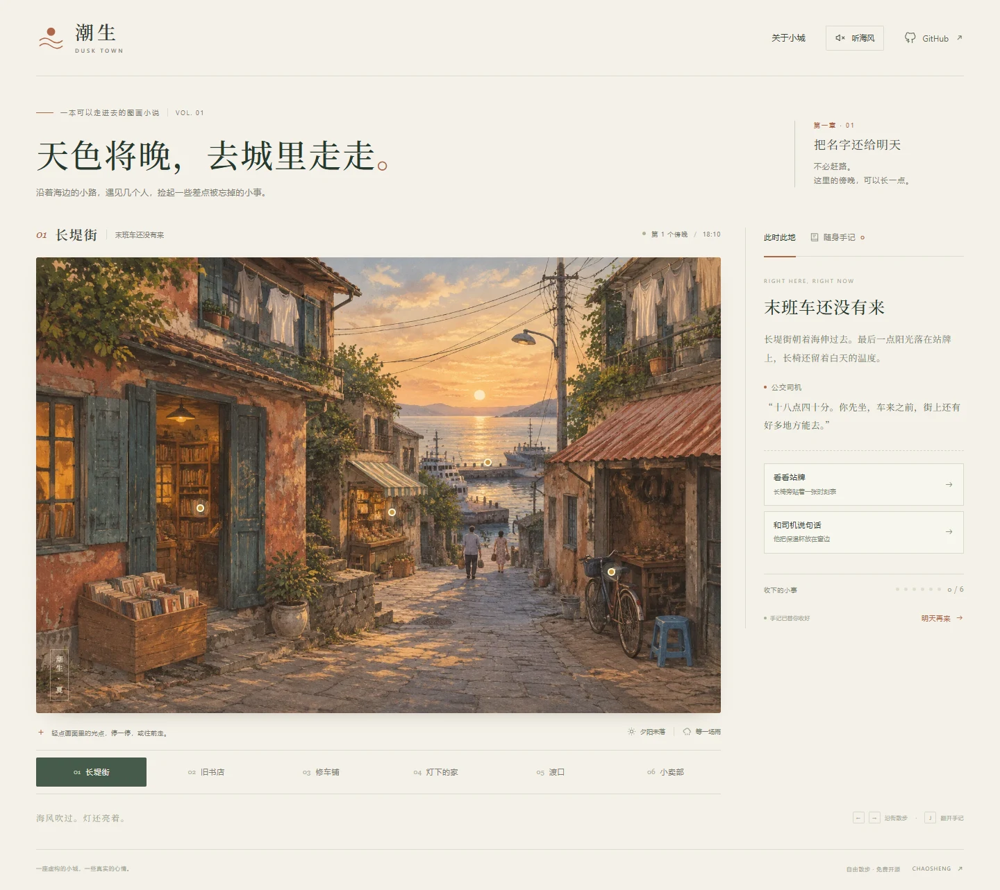

# Chaosheng · Dusk Town

A small seaside town you can walk into. An open-source interactive picture novel.

[Play](https://starrysea1412.github.io/chaosheng/) · [中文](README.md) · [Contributing](CONTRIBUTING.md)



It is six o'clock on a summer evening. The used bookshop is still open, someone is practicing piano upstairs, and the ferry is waiting for its last passenger.

Chapter 01, “Give the Name Back to Tomorrow,” follows a forgotten blue-cloth diary. Explore six locations in any order, meet the residents, and return the diary to Xu Zhou—or agree to meet him tomorrow. There is no countdown.

This first release includes **six locations, six illustrated scene backgrounds, and a complete short story**. The 700-image idea is a future creative budget, documented in the [roadmap](docs/ROADMAP.md).

## The picture album

Version 0.2 includes **120** independently generated paintings: 36 weather/light scene backgrounds, 24 new streets, 24 story moments, 24 object close-ups and 12 resident portraits. [Open the album](https://starrysea1412.github.io/chaosheng/gallery.html) to filter, zoom, turn pages and download the paintings. The six-location interactive chapter now switches between actual sunset, blue-hour, night and rain images; actions also link to illustrated moments. The album uses 480×320 thumbnails and loads full pictures on demand.

## Play and run

Choose a location and click a hotspot or an action button. Discoveries go into your journal, which can be exported as text. Ambient sound is off by default. Change the weather or time of day, or move to another evening. The first release uses CSS filters and an overlay for lighting and rain; these are not separately generated image variants.

Progress is saved in the current browser's `localStorage`. There is no login, cloud save, or runtime AI call. Later evenings currently share a second set of resident dialogue.

Requires Node.js 20 or newer:

```sh
git clone https://github.com/StarrySea1412/chaosheng.git
cd chaosheng
npm install
npm run dev
```

Open <http://127.0.0.1:4318>. Run `npm run verify` for the story tests, source/asset checks, and static build.

The app uses native HTML, CSS, and ES modules with **zero production dependencies**. Story content lives in `src/world.js`; state transitions and save validation live in `src/engine.js`; `src/app.js` renders the interface. The build copies `index.html`, `gallery.html`, `src/`, and `public/` to `dist/`, which GitHub Pages Actions publishes.

## Browser checks

Run `npx playwright install chromium`, then `npm run test:browser`. The suite starts a local server, exercises both diary choices, save recovery, journal export, keyboard controls and mobile layouts, and saves screenshots in `artifacts/`. The Pages workflow runs the suite before publishing.

## License and artwork

Code and story text are licensed under [MIT](LICENSE). Project-generated scene images are offered under [CC BY 4.0](https://creativecommons.org/licenses/by/4.0/) to the extent of the rights held by the maintainers.

The scene illustrations were produced through the user-approved local **Huajing / AI Image Studio**, using `gpt-image-2.5-sunburst`. See [ASSETS.md](ASSETS.md), [art prompts](docs/art-prompts.md), and the [asset manifest](docs/asset-manifest.json) for provenance and attribution.
