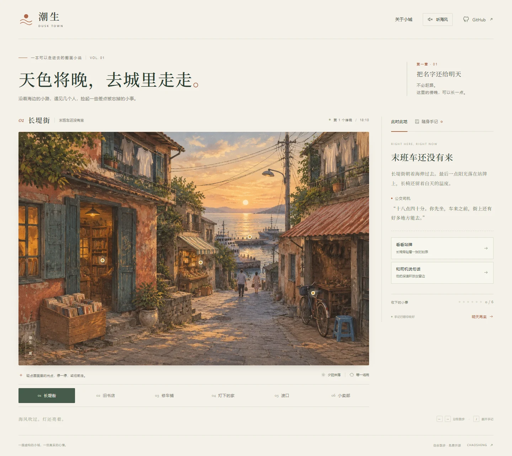

# 潮生 · Dusk Town

一座可以进去散步的海边小城，一本可以玩的图画小说。

[开始散步](https://starrysea1412.github.io/chaosheng/) · [English](README.en.md) · [参与创作](CONTRIBUTING.md) · [未来的小城](docs/ROADMAP.md)



夏天，傍晚六点。旧书店还没打烊，修车铺门口摆着塑料凳，楼上有人练琴，渡口正在等最后一个乘客。你可以沿街走，和人说话，把一些小事记进随身手记。

第一章「把名字还给明天」围绕一本遗落的蓝布日记展开。你可以把它还给许舟，也可以和他约好明天再见。六个地点可以自由探访，故事没有倒计时。

首版包含 **6 个地点、6 张场景插画和一个完整的小故事**。它从“如果有 700 张生图额度，想做什么”这个问题开始；700 张是后续创作的预算设想，见[路线图](docs/ROADMAP.md)。

## 怎么玩

- 选择地点，沿长堤街走到旧书店、修车铺、灯下的家、渡口和小卖部。
- 点击画面中的光点或行动按钮，听人说话、查看物件。
- 打开手记，翻看已经遇见的小事。六个地点各有一条发现，日记故事还会留下额外记录。
- 导出手记文本，带走走过这个傍晚的记录。环境声音默认关闭，可以自行打开。
- 切换时段和天气，看看同一处地方的天色与雨声。首版使用六张基础插画，天气和时段变化由浏览器效果完成。
- 前往下一个傍晚，或隔天回来。已发现的事物和日记选择会保留，居民会换一组回访对白。

存档保存在当前浏览器的 `localStorage`，无需账号。换浏览器或域名不会同步存档，清理网站数据会移除它。游戏运行时不调用 AI，也没有模型使用费用；图片生成发生在素材制作阶段。

## 本地运行

需要 [Node.js](https://nodejs.org/) 20 或更新版本。

```sh
git clone https://github.com/StarrySea1412/chaosheng.git
cd chaosheng
npm install
npm run dev
```

打开 <http://127.0.0.1:4318>。

```sh
npm run test    # 故事分支与存档测试
npm run check   # 源文件与资源检查
npm run build   # 输出静态站点
npm run verify  # 顺序执行 test、check 和 build
```

完整浏览器验收会走过两种日记结局、键盘操作、手记导出、手机光点和隔天回访：

```sh
npx playwright install chromium
npm run test:browser
```

它会自行启动测试服务器，并把桌面、手机和主要故事场景截图保存到 `artifacts/`。GitHub Pages 工作流同时运行这些检查，通过后才发布。

项目使用原生 HTML、CSS 和 ES modules，**没有生产依赖**。构建把 `index.html`、`src/` 和 `public/` 复制到 `dist/`，GitHub Pages Actions 发布这个静态目录，浏览器负责叙事和存档。

## 继续搭建这座城

| 位置 | 内容 |
| --- | --- |
| [`src/world.js`](src/world.js) | 地点、人物对白、发现、行动和画面光点位置 |
| [`src/engine.js`](src/engine.js) | 状态变化、行动条件、日记分支和存档恢复 |
| [`src/app.js`](src/app.js)、[`src/styles.css`](src/styles.css) | 画面、导航、行动、手记、导出与对话框 |
| [`src/sound.js`](src/sound.js) | 默认关闭的环境声音 |
| [`public/scenes/`](public/scenes/) | 六张场景插画 |
| [`docs/WORLD.md`](docs/WORLD.md) | 人物、地点与故事的一致性约定 |
| [`docs/art-prompts.md`](docs/art-prompts.md)、[`docs/asset-manifest.json`](docs/asset-manifest.json) | 素材提示词、实际生成来源与校验记录 |

添一条街、改一句对白、修一个手机上的按钮，都可以成为一次贡献。具体步骤见[贡献指南](CONTRIBUTING.md)。

## 许可与素材

代码和故事文本采用 [MIT](LICENSE)。本项目生成的场景插画在维护者持有的权利范围内采用 [CC BY 4.0](https://creativecommons.org/licenses/by/4.0/)；复用时请署名并注明修改。

首版插画经用户指定的本机 **画境 / AI Image Studio** 制作，使用 `gpt-image-2.5-sunburst`。AI 辅助生成的来源、文件和许可范围见 [ASSETS.md](ASSETS.md)，实际任务记录见素材清单。
